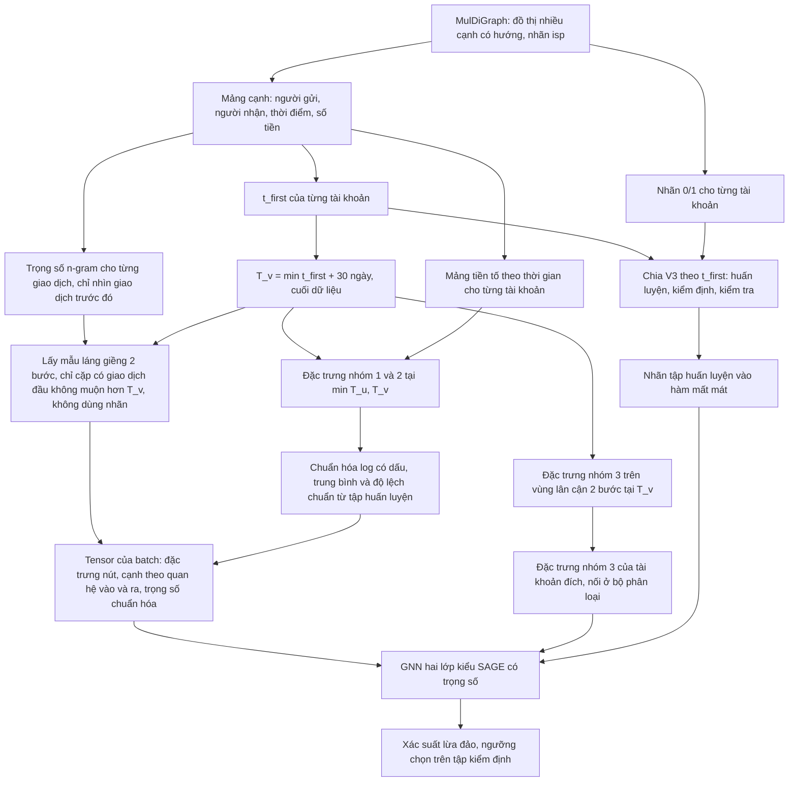

# Bài toán và dữ liệu

Số liệu theo định dạng quốc tế: dấu chấm thập phân, dấu phẩy phân cách hàng nghìn. Mã bằng chứng dạng E1, E2 tra trong file 06.

## 1. Bài toán

Nghiên cứu này xếp hạng các tài khoản Ethereum mới theo nguy cơ lừa đảo trực tuyến (phishing), dùng thông tin quan sát được trong 30 ngày đầu kể từ giao dịch đầu tiên của tài khoản. Đối tượng dự đoán là một tài khoản (một địa chỉ), không phải một giao dịch [Đã xác minh, E2].

Nhãn 1 nghĩa là tài khoản lừa đảo đã được xác nhận trong bộ dữ liệu (thuộc tính isp bằng 1). Nhãn 0 nghĩa là mọi tài khoản còn lại, gồm cả tài khoản chưa từng được kiểm tra [Đã xác minh, E2]. Vì vậy nhãn 0 mang nghĩa "chưa biết là lừa đảo", không có nghĩa là "đã xác nhận lành tính".

Bài toán thuộc loại phát hiện gian lận trên đồ thị giao dịch. Mỗi tài khoản là một nút. Mỗi giao dịch là một cạnh có hướng, mang hai thuộc tính: số tiền và thời điểm [Đã xác minh, E1].

## 2. Nguồn dữ liệu

Bộ dữ liệu MulDiGraph (nền tảng XBlock) là nguồn duy nhất của mọi kết quả trong báo cáo này. Bảng 1 tóm tắt quy mô do script audit đếm lại trực tiếp từ dữ liệu.

Bảng 1. Quy mô bộ dữ liệu MulDiGraph

| Đại lượng | Giá trị | Bằng chứng |
|---|---:|---|
| Tài khoản (nút) | 2,973,489 | E1 |
| Giao dịch (cạnh có hướng, cho phép nhiều cạnh giữa một cặp) | 13,551,303 | E1 |
| Cặp (gửi, nhận) phân biệt | 5,355,155 | E1 |
| Tài khoản lừa đảo đã xác nhận | 1165 | E2 |
| Tỷ lệ tài khoản lừa đảo | 0.039% | E2 |
| Khoảng thời gian | 2015-08-07 đến 2019-01-19 | E1 |

Dữ liệu có ba đặc điểm ảnh hưởng tới cách đánh giá.

- Bộ dữ liệu được thu thập bằng tìm kiếm theo chiều rộng 2 bước xuất phát từ các tài khoản lừa đảo. Hệ quả là 91%, 80% và 82% tài khoản thường của ba tập nằm trong 2 bước tới một tài khoản lừa đảo [Đã xác minh, E22]. Mục 3 của file 02 phân tích hệ quả của cách thu thập này lên bậc của nút.
- Dữ liệu không ghi thời điểm gán nhãn. Một tài khoản có thể bị gắn nhãn lừa đảo sau thời điểm dự đoán [Suy luận, E32].
- Giao dịch giá trị 0 chiếm 67.54% số cạnh. Cạnh trùng hoàn toàn (cùng người gửi, người nhận, thời điểm và số tiền) chiếm 11.0%. Có 5,926 self-loop [Đã xác minh, E24]. Repo chưa giải thích nguồn gốc các cạnh này [Chưa xác định: cần đối chiếu với mô tả của XBlock xem cạnh giá trị 0 là gọi hợp đồng hay chuyển token, vì chúng chiếm phần lớn tín hiệu tần suất].

Danh sách 5,480 địa chỉ lừa đảo cũ chỉ trùng 963 địa chỉ với nhãn isp. Dự án đã bỏ danh sách cũ và chỉ dùng nhãn isp [Đã xác minh, E2].

## 3. Chia tập

Dự án chia tài khoản theo thời điểm giao dịch đầu tiên của tài khoản (ký hiệu t_first). Mỗi tài khoản thuộc đúng một tập, không có tài khoản trùng giữa các tập [Đã xác minh, E3, E4]. Hai mốc cắt t1 và t2 là phân vị 0.65 và 0.80 của t_first, tính trên riêng các tài khoản lừa đảo [Đã xác minh, E3].

Bảng 2. Ba tập theo cách chia V3

| Tập | Quy tắc | Tài khoản | Tài khoản lừa đảo | Tỷ lệ lừa đảo |
|---|---|---:|---:|---:|
| Tập huấn luyện | t_first trước 2018-05-18 | 2,217,282 | 757 | 0.034% |
| Tập kiểm định (validation set) | t_first từ 2018-05-18 đến trước 2018-06-18 | 268,352 | 175 | 0.065% |
| Tập kiểm tra (test set) | t_first từ 2018-06-18 | 487,855 | 233 | 0.048% |

Tập kiểm định chỉ dài 31.48 ngày [Đã xác minh, E4]. Báo cáo này gọi cách chia trong Bảng 2 là "V3". File 02 đánh giá cách chia này và các loại rò rỉ dữ liệu.

## 4. Thời điểm dự đoán và đặc trưng

Thời điểm dự đoán (prediction time) của tài khoản v là T_v, bằng t_first của v cộng 30 ngày [Đã xác minh, E5]. T_v không vượt quá thời điểm giao dịch cuối của bộ dữ liệu. Mọi đặc trưng và mọi cạnh mà mô hình thấy khi chấm tài khoản v phải xảy ra không muộn hơn T_v. Báo cáo này gọi giao thức V3 có áp dụng ràng buộc T_v cho cả đặc trưng lẫn đồ thị là "V3-sạch".

Dự án có ba bộ đặc trưng, khác nhau ở cửa sổ thời gian.

- Bộ đặc trưng cũ 23 cột: 18 cột nhóm 1 và 2 (bậc vào, bậc ra, số tiền lớn nhất, nhỏ nhất, trung bình, số dư, thời gian hoạt động, tần suất theo cửa sổ 30 và 180 ngày) cộng 5 cột nhóm 3 (độ trung tâm và hệ số phân cụm trên vùng lân cận 2 bước). Bộ này tính trên toàn bộ lịch sử tài khoản, kể cả sau T_v [Đã xác minh, E8].
- Bộ đặc trưng mới 18 cột: cùng định nghĩa nhóm 1 và 2, chỉ dùng giao dịch không muộn hơn T_v [Đã xác minh, E6].
- Bộ đặc trưng mới 23 cột: bộ mới 18 cột cộng nhóm 3 tính trên vùng lân cận 2 bước chỉ gồm giao dịch không muộn hơn T_v [Đã xác minh, E7].

Khi bỏ ràng buộc thời gian, code tạo bộ mới tái tạo bộ cũ với sai lệch lớn nhất bằng 0 [Đã xác minh, E6]. Script audit cũng đếm lại độc lập bậc vào và bậc ra tại T_v. Kết quả khớp hoàn toàn với bộ mới [Đã xác minh, E6].

## 5. Luồng dữ liệu

Hình 1 trình bày luồng dữ liệu của pipeline V3-sạch, từ đồ thị gốc tới tensor đưa vào mạng nơ-ron đồ thị (graph neural network, GNN).

Hình 1. Luồng dữ liệu của pipeline V3-sạch

## 6. Bảng input và output

Bảng 3 liệt kê từng lớp dữ liệu, từ đầu vào thô tới quyết định cuối cùng, chỉ theo những gì có trong code của pipeline V3-sạch.

Bảng 3. Input, biến đổi và output của pipeline V3-sạch

| Thành phần | Input | Biến đổi | Output | Mục đích | Rủi ro cần kiểm tra |
|---|---|---|---|---|---|
| 1. Đầu vào thô | Đồ thị MulDiGraph | Đọc một lần, chuyển thành mảng cạnh và danh sách địa chỉ (E1) | 13,551,303 cạnh với thời điểm và số tiền | Tránh nạp lại đồ thị lớn | Cạnh giá trị 0, cạnh trùng, self-loop (E24) |
| 2. Nhãn | Thuộc tính isp của nút | Gán 1 nếu isp bằng 1 (E2) | 1165 tài khoản nhãn 1 | Định nghĩa tài khoản lừa đảo | Không có thời điểm gán nhãn (E32) |
| 3. Chia tập | t_first, nhãn | Mốc t1, t2 là phân vị trên t_first của tài khoản lừa đảo (E3) | Ba tập rời nhau | Đánh giá trên tài khoản xuất hiện sau | Mốc cắt dùng nhãn của cả ba tập (E3) |
| 4. Đầu vào sau tiền xử lý | Mảng cạnh, T_v | Đặc trưng nhóm 1 và 2 tại min(T_u, T_v), nhóm 3 tại T_v (E6, E7) | Ma trận đặc trưng 18 cột cho mọi nút trong batch, 5 cột cho tài khoản đích | Mô tả hành vi trong 30 ngày đầu | Cửa sổ của tập kiểm định chạm giai đoạn kiểm tra (E25) |
| 5. Đầu vào nhánh đồ thị | Mảng tiền tố, T_v | Lấy mẫu láng giềng 2 bước theo quan hệ vào và ra, trọng số cặp cộng dồn tới T_v (E9) | Danh sách cạnh và trọng số chuẩn hóa | Đưa cấu trúc giao dịch quanh tài khoản vào mô hình | Bậc nút bị ảnh hưởng bởi cách thu thập (E23) |
| 6. Biểu diễn trung gian | Tensor của batch | GNN hai lớp tổng hợp có trọng số, mỗi quan hệ một ma trận (E9) | Vector 64 chiều của tài khoản đích | Kết hợp đặc trưng của tài khoản và láng giềng | Độ lệch giữa các seed lớn (E15) |
| 7. Điểm dự đoán | Vector trung gian, nhóm 3 của tài khoản đích | Hai lớp tuyến tính, softmax (E9) | Xác suất lớp 1 | Xếp hạng tài khoản | Xác suất lệch vì huấn luyện với tỷ lệ âm dương 3:1 (E36) |
| 8. Quyết định cuối | Xác suất | Ngưỡng tối đa hóa F1-score trên tập kiểm định (E12) | Nhãn dự đoán 0 hoặc 1 | Cảnh báo tài khoản | Ngưỡng từ 0.971 trở lên, sát giá trị tối đa của xác suất, nên nhạy với dịch chuyển phân phối (E36) |

Ba loại thông tin đầu vào có thời điểm quan sát khác nhau.

- Đặc trưng của chính tài khoản đích quan sát được từ t_first tới T_v.
- Cấu trúc đồ thị gồm các cặp có giao dịch đầu tiên không muộn hơn T_v. Đặc trưng của láng giềng u tính tại min(T_u, T_v), nên láng giềng cũng không mang thông tin sau T_v.
- Chuỗi giao dịch dạng văn bản chỉ có trong các mô hình cũ dùng BERT (Bidirectional Encoder Representations from Transformers). Nhánh BERT dùng toàn bộ lịch sử tài khoản, không cắt tại T_v [Đã xác minh, E19]. Pipeline V3-sạch không dùng nhánh văn bản.

Output của mô hình là xác suất. Mô hình chỉ thành quyết định 0 hoặc 1 sau khi áp ngưỡng chọn trên tập kiểm định. Metric chính là diện tích dưới đường Precision-Recall (area under the precision-recall curve, AUPRC), vì tỷ lệ lớp dương trên tập kiểm tra chỉ là 0.048%.

## 7. Giả định

| Giả định | Trạng thái | Hệ quả nếu sai |
|---|---|---|
| Nhãn isp đúng và đầy đủ cho mọi tài khoản lừa đảo trong phạm vi thu thập | [Chưa xác định: XBlock không công bố quy trình gán nhãn trong repo] | Nhãn 0 chứa tài khoản lừa đảo chưa phát hiện, AUPRC bị đánh giá thấp |
| Thông tin trong 30 ngày đầu là đủ để phát hiện | [Suy luận] | Cửa sổ khác cho kết quả khác, cần thí nghiệm độ nhạy (file 05) |
| Trọng số n-gram chỉ nhìn giao dịch trước đó | [Đã xác minh, E9] | Nếu sai, trọng số cạnh mang thông tin tương lai |
| Quần thể tài khoản thường trong MulDiGraph đại diện cho Ethereum | [Chưa xác định: 87.66% tài khoản thường nằm cách tài khoản lừa đảo đúng 2 bước, E23] | Kết quả không khái quát ra ngoài bộ dữ liệu |
