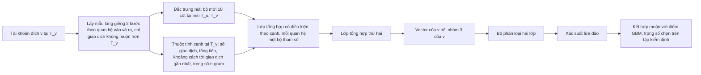

# Đề xuất mô hình

Số liệu theo định dạng quốc tế. Mã bằng chứng tra trong file 06, số liệu của file này lấy từ E14, E15, E22. Mọi kết quả trong file này là diện tích dưới đường Precision-Recall (area under the precision-recall curve, AUPRC) trên tập kiểm tra của V3, trừ khi ghi khác. Tập kiểm tra gồm 487,855 tài khoản và 233 tài khoản lừa đảo. Mỗi kết quả là trung bình và độ lệch chuẩn qua 5 seed (giá trị khởi tạo ngẫu nhiên).

## 1. Baseline

Mô hình tốt nhất hiện có là mạng nơ-ron đồ thị (graph neural network, GNN) time-aware hai chiều có thêm nhóm đặc trưng 3, đạt 0.531 ± 0.036 trên V3-sạch [Đã xác minh, E15]. Time-aware nghĩa là mỗi tài khoản chỉ được chấm trên các giao dịch xảy ra tới T_v của nó. Baseline dạng bảng tốt nhất không rò rỉ dữ liệu (data leakage) là gradient boosting (GBM) với bộ mới 23 cột, đạt 0.360 ± 0.004 [Đã xác minh, E14]. Bảng 1 xếp các mô hình theo trạng thái bằng chứng. Trong Bảng 1, mô hình ngôn ngữ tiền huấn luyện (BERT) xử lý văn bản giao dịch. Mạng tích chập đồ thị (graph convolutional network, GCN) học trên đồ thị.

Bảng 1. Mô hình và baseline hiện có

| Mô hình | Đầu vào | Giao thức | AUPRC | Trạng thái | Bằng chứng |
|---|---|---|---:|---|---|
| Điểm ngẫu nhiên | Không | V3 | 0.0005 | Mốc tham chiếu | E22 |
| Khoảng cách tới tài khoản lừa đảo của tập huấn luyện | Nhãn tập huấn luyện | V3-sạch | 0.0010 | Có kết quả đáng tin | E22 |
| Chỉ dùng bậc nút | Bậc tại T_v | V3-sạch | 0.0123 (seed 0) | Có kết quả đáng tin | E23 |
| GBM | Bộ mới 18 cột | V3-sạch | 0.303 ± 0.015 | Có kết quả đáng tin | E14 |
| GBM | Bộ mới 23 cột | V3-sạch | 0.360 ± 0.004 | Có kết quả đáng tin | E14 |
| FraudGT | Cạnh (thời điểm, số tiền) | V3, đồ thị kiểm tra đầy đủ | 0.332 (1 seed) | Chạy được, còn rò rỉ đồ thị | E27 |
| GNN time-aware, chỉ quan hệ vào | Bộ mới 18 cột | V3-sạch | 0.483 ± 0.040 | Có kết quả đáng tin | E15 |
| GNN time-aware, hai chiều | Bộ mới 18 cột | V3-sạch | 0.509 ± 0.049 | Có kết quả đáng tin | E15 |
| GNN time-aware, hai chiều, thêm nhóm 3 | Bộ mới 18 cột, nhóm 3 của tài khoản đích | V3-sạch | 0.531 ± 0.036 | Có kết quả đáng tin | E15 |
| E2: BERT và GraphSAGE kết hợp | Bộ cũ 23 cột, văn bản toàn lịch sử | V3 | 0.243 (1 seed) | Chạy được, còn bốn nguồn rò rỉ | E19 |
| tri_model (tái hiện bài báo Dynamic Feature Fusion) | BERT, GCN theo vocab, đặc trưng | Chia cũ | 0.124 (toàn bộ tập kiểm tra cũ) | Chạy được, transductive | E20, E21 |
| LMAE4Eth (tái hiện) | Chuỗi giao dịch, đồ thị, đặc trưng chuyên gia | Chia ngẫu nhiên | F1-score 0.2799 | Chạy được, khác giao thức | E28 |
| TLmGNN | Câu giao dịch, đồ thị vocab | Không | Không có | Chưa chạy | E28 |

Chỉ năm dòng có trạng thái "Có kết quả đáng tin" và giao thức V3-sạch được dùng làm baseline trong thí nghiệm mới.

## 2. Vấn đề còn tồn tại

Bốn vấn đề sau có bằng chứng trong repo.

1. Độ lệch giữa các seed lớn so với chênh lệch giữa các biến thể. GNN hai chiều có độ lệch chuẩn 0.049, trong khi chênh lệch giữa có và không có nhóm 3 chỉ là 0.022 [Đã xác minh, E15]. Repo chưa có kiểm định ghép cặp giữa các mô hình.
2. GNN chỉ dùng trọng số n-gram cộng dồn của mỗi cặp. Số tiền và khoảng thời gian giữa các giao dịch trên từng cạnh không đi vào phép truyền thông điệp [Đã xác minh, E9]. FraudGT dùng thuộc tính cạnh nhưng chưa được đánh giá trên V3-sạch.
3. Nhánh văn bản dùng BERT không cộng thêm tín hiệu. Trên cách chia cũ, kết hợp BERT với GraphSAGE đạt 0.144, thấp hơn 0.303 của GNN không có BERT [Đã xác minh, E21]. Trên V3, kết hợp này đạt 0.243 [Đã xác minh, E19].
4. Xác suất đầu ra lệch mạnh. Mô hình huấn luyện với tỷ lệ âm dương 3:1 trong khi tỷ lệ thật là 0.048%, nên ngưỡng F1-score chọn trên tập kiểm định nằm trong khoảng từ 0.971 trở lên [Đã xác minh, E36]. Ngưỡng sát giá trị tối đa dễ thay đổi khi phân phối dịch chuyển.

Báo cáo này không coi kiến trúc GNN là điểm yếu chính. Với cùng bộ mới 18 cột, GNN chỉ quan hệ vào đạt 0.483 ± 0.040, cao hơn 0.303 ± 0.015 của GBM [Đã xác minh, E14, E15].

## 3. Kiến trúc đề xuất

Phương án ưu tiên là GNN time-aware có thuộc tính cạnh theo thời gian [Đề xuất]. Mô hình giữ nguyên giao thức V3-sạch và bộ lấy mẫu hiện tại, chỉ thêm thông tin cạnh vào phép tổng hợp. Hình 1 trình bày kiến trúc.

Hình 1. Kiến trúc GNN time-aware có thuộc tính cạnh

| Thành phần | Nội dung |
|---|---|
| Đầu vào | Tài khoản đích v, T_v, đồ thị giao dịch cắt tại T_v |
| Nhánh nút | Bộ mới 18 cột của mọi nút trong cây lấy mẫu, chuẩn hóa từ tập huấn luyện |
| Nhánh cạnh | Bốn thuộc tính của mỗi cặp, tính từ mảng tiền tố đã có, chỉ dùng giao dịch không muộn hơn T_v |
| Cách kết hợp | Thông điệp từ u tới v là hàm của đặc trưng u và thuộc tính cạnh, theo kiểu mạng đẳng cấu đồ thị có thuộc tính cạnh (GINE) |
| Đầu ra | Xác suất lớp 1 |
| Hàm mất mát | Cross-entropy trên nhãn tập huấn luyện, lấy mẫu âm theo tỷ lệ 3:1 như hiện tại |
| Kết hợp muộn | Trung bình có trọng số giữa xác suất GNN và GBM, trọng số chọn trên tập kiểm định |

## 4. Lý do thiết kế

| Thành phần | Vấn đề giải quyết | Giả thuyết |
|---|---|---|
| Thuộc tính cạnh theo thời gian | Vấn đề 2 | H1: nhịp và lượng tiền trên từng cạnh trong 30 ngày đầu mang tín hiệu mà trọng số n-gram cộng dồn làm mất |
| Giữ hai quan hệ vào và ra | Kết quả đã có: hai chiều cao hơn một chiều | H2: tài khoản lừa đảo khác tài khoản thường ở cả phía nhận và phía gửi |
| Kết hợp muộn với GBM | Vấn đề 1 và tín hiệu bổ sung | H3: GBM và GNN sai ở những tài khoản khác nhau, nên kết hợp tăng AUPRC |
| Không dùng nhánh BERT | Vấn đề 3 | Nhánh văn bản tốn chi phí mà không thêm tín hiệu trên bộ dữ liệu này |

Bằng chứng cho H3 hiện chỉ có trên cách chia cũ, nơi kết hợp GBM với GNN đạt 0.474 ở một seed [Suy luận, E21]. Kết quả đó còn rò rỉ đặc trưng nên chỉ dùng làm động lực, không dùng làm kết quả.

## 5. Tính mới

Đóng góp dự kiến của nghiên cứu nằm ở giao thức đánh giá và phân tích, không nằm ở kiến trúc.

- Đã có trong nghiên cứu trước: lấy mẫu láng giềng theo thời gian của các mô hình đồ thị động như Temporal Graph Networks (TGN), tổng hợp có điều kiện theo cạnh như GINE, kết hợp muộn nhiều mô hình.
- Tái sử dụng: bộ lấy mẫu V3-sạch, mảng tiền tố, đặc trưng tại T_v, GBM.
- Đóng góp dự kiến: một giao thức không rò rỉ cho MulDiGraph với snapshot riêng cho từng tài khoản. Kèm theo là phép đo mức thổi phồng của từng nguồn rò rỉ dữ liệu. Phần thứ ba là phân tích thiên lệch thu thập qua bậc nút [Đề xuất].

Báo cáo này không gọi mô hình đề xuất là mới về kiến trúc. Chưa có so sánh với các mô hình đồ thị theo thời gian công khai trên cùng giao thức (file 04).

## 6. Ablation

Mỗi thí nghiệm ablation (thí nghiệm bỏ lần lượt từng thành phần) trả lời một câu hỏi.

| Thí nghiệm | Bỏ hoặc thay | Câu hỏi |
|---|---|---|
| A1 | Bỏ thuộc tính cạnh | Thuộc tính cạnh có thêm tín hiệu không (H1)? |
| A2 | Thay trọng số n-gram bằng trọng số đều | Công thức trọng số của bài báo gốc có giá trị không? |
| A3 | Bỏ quan hệ ra | Phía gửi có thêm tín hiệu không (H2)? |
| A4 | Bỏ nhóm 3 của tài khoản đích | Nhóm 3 có thêm tín hiệu cho GNN không? |
| A5 | Bỏ GBM trong kết hợp muộn | Kết hợp có tốt hơn từng mô hình không (H3)? |
| A6 | Cửa sổ 7 ngày thay cho 30 ngày | Phát hiện sớm hơn mất bao nhiêu AUPRC? |

## 7. Đánh giá

- Metric chính: AUPRC, định nghĩa theo code đánh giá hiện có (E37). Metric phụ: Precision@100 (tỷ lệ tài khoản lừa đảo trong 100 tài khoản điểm cao nhất), Recall@1000, F1-score tại ngưỡng chọn trên tập kiểm định. ROC-AUC chỉ báo cáo kèm cảnh báo ở file 02, mục 3.
- Mọi mô hình chạy 5 seed, báo cáo trung bình và độ lệch chuẩn.
- So sánh hai mô hình bằng bootstrap ghép cặp trên cùng tập kiểm tra, 1000 lần lấy mẫu lại.
- Baseline được tinh chỉnh công bằng: GBM và mọi biến thể GNN chọn siêu tham số trên tập kiểm định với cùng ngân sách số cấu hình.
- Báo cáo thêm AUPRC trên tập con bậc ít nhất 2.

## 8. Rủi ro

| Rủi ro | Mức | Cách giảm |
|---|---|---|
| Thuộc tính cạnh mang thông tin sau T_v do lỗi chỉ số | Cao | Assert thời điểm cho từng cạnh, kiểm tra hồi quy như với bộ đặc trưng mới |
| Chênh lệch nhỏ hơn độ lệch giữa các seed | Cao | Bootstrap ghép cặp, đánh giá cuốn chiếu (file 02, mục 6.2) |
| Mô hình học vị trí trong vùng thu thập bằng tìm kiếm theo chiều rộng thay vì hành vi | Trung bình | Chấm trên tập con bậc ít nhất 2 |
| Chi phí tăng khi thêm thuộc tính cạnh | Thấp | Thuộc tính tính từ mảng tiền tố đã có |
| Kết quả không khái quát ra ngoài MulDiGraph | Cao | Ghi rõ là giới hạn, cần bộ dữ liệu thứ hai để kiểm chứng |

## 9. So sánh các phương án ứng viên

Bảng 2 so sánh bốn phương án theo năm tiêu chí. Phương án B được chọn làm ưu tiên. Phương án A chạy song song làm baseline vì chi phí gần bằng 0.

Bảng 2. So sánh phương án mô hình

| Phương án | Hiệu quả dự kiến | Chi phí | Khả năng triển khai | Độ phức tạp | Mức độ bằng chứng |
|---|---|---|---|---|---|
| A. Kết hợp muộn GNN time-aware với GBM | Trung bình | Gần bằng 0, dùng lại mô hình đã huấn luyện | Cao | Thấp | Chỉ có trên cách chia cũ, một seed |
| B. GNN time-aware có thuộc tính cạnh (ưu tiên) | Trung bình đến cao | Thấp đến trung bình | Cao, dùng lại toàn bộ code V3-sạch | Trung bình | Gián tiếp: cấu trúc đã giúp, thuộc tính cạnh chưa thử |
| C. Kết hợp BERT với GNN, cắt văn bản tại T_v | Thấp | Cao | Trung bình | Cao | Bằng chứng ngược chiều trên cả hai cách chia |
| D. Mô hình đồ thị động công khai như TGN, DyGFormer | Chưa rõ | Trung bình đến cao | Trung bình, cần chuyển dữ liệu sang định dạng thư viện | Cao | Chưa có trên bộ dữ liệu này |

Phương án B được chọn vì chi phí thấp và dùng lại code đã kiểm chứng. Phương án B cũng kiểm tra trực tiếp được giả thuyết H1. Phương án D nên chạy như baseline bên ngoài sau khi B có kết quả (file 05).
